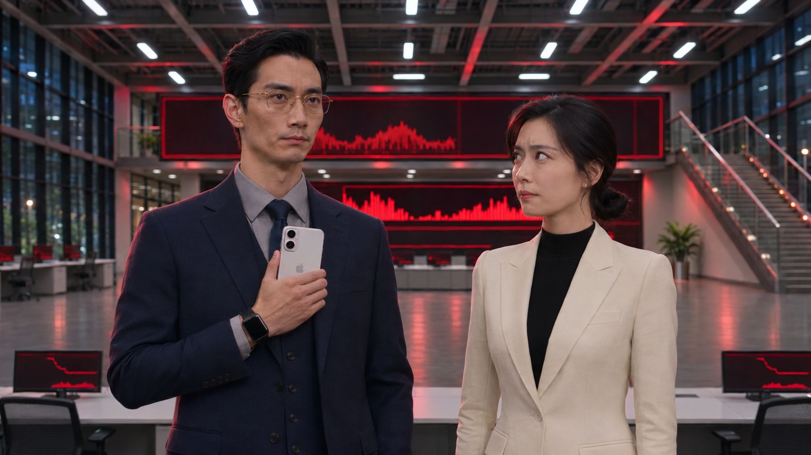

> **此页第一张正面并排参考图已被用户否决，保留作历史。当前使用[已确认错位站位与低位持机版](007_错位站位低位持机说明.md)。不要再挂载本页旧图或从下面旧正文发起新生成。**

# EP01-007 大厅融合参考图版｜2026-11-10

本轮先生成真实的大厅双人同框参考，再接入007提示词。保留用户满意的表演、站位、台词、镜头节奏、30秒时长和最后拿箱动作；保留上一轮雨水可见性要求。原稿及上轮修订文件均未覆盖。

| 入口 | 挂图与完整说明 | 直接复制 |
|---|---|---|
| 30图入口，实际14张 | [完整稿](30张参考版/分镜007_融合参考图与雨水修订版.txt) | [仅生成正文](30张参考版/分镜007_融合参考图与雨水_仅生成正文.txt) |
| 9图入口，仍为9张 | [完整稿](9张参考版/分镜007_融合参考图与雨水修订版.txt) | [仅生成正文](9张参考版/分镜007_融合参考图与雨水_仅生成正文.txt) |

## 挂图变化

30图版：上一版1—13号不变，在最后追加本图为图片14，实际14张。图片5仍是原大厅地理板，图片14管人物与现场光影融合。

9图版：图片5替换为本图，不能保留旧大厅图再追加为第10张。图片4仍用已采用006落箱实帧，图片8仍用已采用006真实末帧，图片9仍为黑伞。完整稿按1—9顺序挂载。

本图只用于大厅镜头的空间、现场光线、肤质、衣料与景深参考。不能设成整段007的初始帧：整段开场仍用采用006真实尾帧，周衍右手手机贴右耳、左手撑伞、通话已接通。大厅第29镜仍先贴耳→降机→开启免提，不照搬本图已经胸前持机的时刻。后续表演、取机和手部交接仍按原正文。

## 图片来源及观察

图片由本轮图像生成实际产出，输入是用户上传 mmexport1794282573512.mp4 约8秒实帧。保持男左女右、现有服装、右侧楼梯及后方巨幕，将现场顶灯、环境红光、自然明暗与皮肤衣料质感统一。已目视核对完整生成图：两人、银色手机、白色顶灯、红色曲线屏和楼梯均可见。它是新生成候选，未获用户采用，也未验证视频效果；不能声称完全消除合成感或像素级保持原建筑。

原始生成PNG为1672×941，仍在本轮对话中提供。仓库提供同尺寸高质量JPEG（quality 95，4:4:4），没有缩放、裁剪或重新构图；文件为 assets/props/EP01-007-HALL-INTEGRATED.jpg。图中手机背壳可见品牌标记，视频正文明确不继承该标记；屏幕只保留无字红色图形。画幅为生成图近似16:9，视频任务继续设16:9，不以本图代替输出参数。

## 复核结果与下一步

两版原台词、8镜顺序与秒段一致；9图正文只引用1—9，30图只引用1—14；两版仅生成正文与各自完整稿正文相同。没有提交视频生成任务。

生成后看3—11、15—19、20—23秒是否仍有贴图感，确认面部受光、衣肩边缘、同距离清晰度及背景景深融合；不把静态图姿势冻结成全段站姿。23—30秒检查持续伞外雨丝、伞沿滴水与地面溅点，动作仍先收手机再托箱、左手伞。拍完以实际媒体判断采用。

[上一轮文字修订与原稿关系](007_光影融合与雨水修订说明.md)；[006采用及制作交接](../制作交接_2026-11-09.md)。本页为最新测试入口，旧入口留作回退对比。
