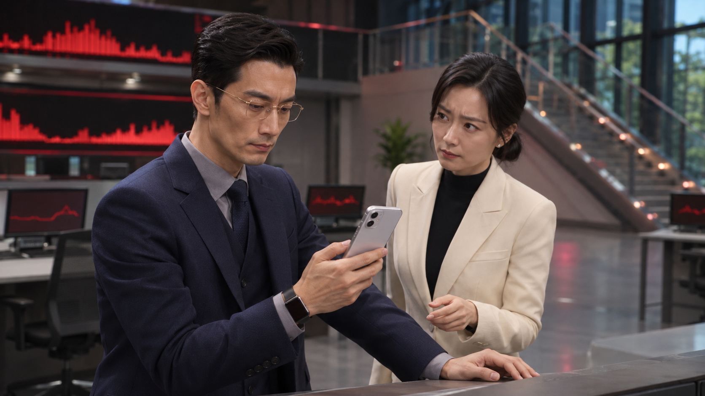

# EP01-007 已确认错位站位与低位持机｜2026-11-10

用户已确认本轮参考图：“这个可以”，并要求“手机也不要放在胸前，就这个位置就可以”“动作连贯性这些也考虑进去，千万不要违和了”。本轮据此更新两版提示词。参考图的认可不等于新视频已采用；视频尚未生成或验收。

| 版本 | 挂图与完整稿 | 直接复制正文 |
|---|---|---|
| 30图入口，实际14张 | [完整稿](30张参考版/分镜007_错位站位低位持机_完整稿.txt) | [正文](30张参考版/分镜007_错位站位低位持机_仅生成正文.txt) |
| 9图入口，仍为9张 | [完整稿](9张参考版/分镜007_错位站位低位持机_完整稿.txt) | [正文](9张参考版/分镜007_错位站位低位持机_仅生成正文.txt) |

## 挂图

30图版：第14张换成本页新图，其余1—13不变。9图版：第5张换成本页新图，第4仍为已采用006落箱实帧、第8仍为采用006末帧；其余图不变。不要再挂上一张 EP01-007-HALL-INTEGRATED.jpg，用户已否决那张正面并排图。本轮新图文件：assets/props/EP01-007-HALL-STAGGERED.jpg。

新图不是007整段初始帧。整段仍从006真实尾帧、周衍右手手机贴右耳且通话已接通开始。大厅新图管错位站位、手机高度、现场光影及空间，不把静态表情冻结成整个视频。

## 动作连续性

大厅：贺凯左前靠原控制台、秦岚右后半步，仍伸手可及；贺凯左手轻搭台边。第29镜从右手手机贴耳开始，在同一镜内降到参考所示身前较低位置，约下胸至上腹、靠台侧且离开身体，随后点免提。不要在胸口贴着手机，不在说话重音时上下举机。

第32镜保持同一低位、同一左右手及台边接触点，表演意图和台词触发沿用原稿。第34镜秦岚从既有右后方站位微微前倾，右手在手机现有高度握稳，贺凯迟半拍松指；随后她把手机收回自己身前上腹高度，贺凯空右手落到腰侧，左手仍靠台。不新增递手机、抬至胸口、镜外换手或绕台动作。

参考图腕部饰物及持机手可能带来左右手理解歧义，视频不照搬这部分：延续006，贺凯始终右手持机、左手台边、左腕一只表；秦岚右手取机。图仅锁已认可的站位、较低持机高度及融合质感。窗外连续雨夜，不继承参考窗外偏亮天色。

室外第28、30、31、33、35镜动作未改。周衍左手伞、右手机，挂断后先完全收进左胸内袋并抽出空手，再屈膝接触箱底、右掌及前臂承重后拿箱、站稳迈步。23—30秒持续保留伞外雨丝、伞沿滴水、地面溅点。没有给周衍增加靠台动作或新的站位。

## 保持与校验

30秒、8子镜、全部原台词、镜头顺序与秒段不变，人物表演意图保留；本次只为新站位和手机高度调整动作实现与镜头取景。两版正文与完整稿一致；大厅三个镜头不再保留胸前持机要求，9图引用不越界，并修正旧9图挂图说明里残留的图片13标记。

原稿、文字融合版、第一次融合参考图版都保留；第一次参考图版已标注停用入口。静态新图用户已认可，但动态手部交接、靠台接触、光影融合、台词与末镜雨势仍必须实片验收，不能凭提示词判为通过。

图片由本轮图像生成产出，来源为 mmexport1794282573512.mp4 约8秒实帧，用户随后要求换站位。原PNG1672×941；仓库同尺寸JPEG quality95、4:4:4，无缩放裁剪。视频设置仍Seedance2.5、16:9、30秒，沿用既定分辨率，本轮未生成视频或改码率。
